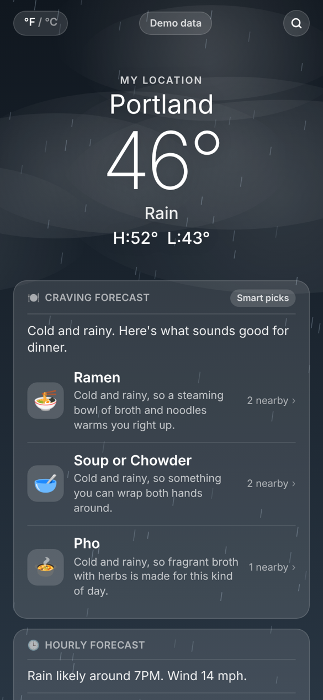
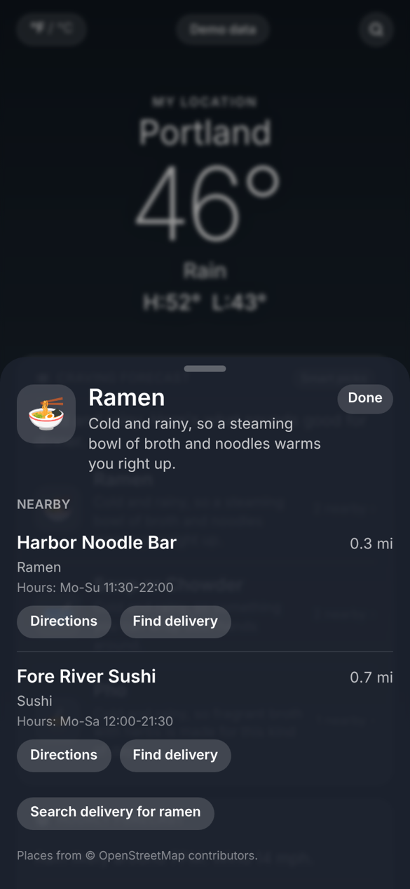
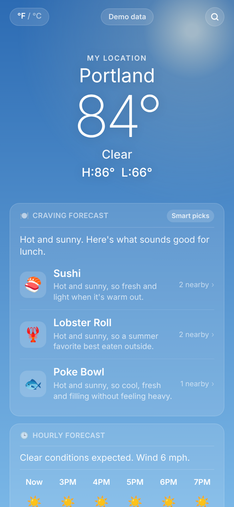
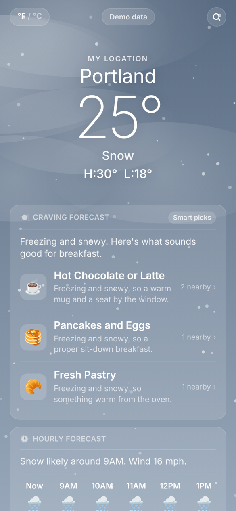
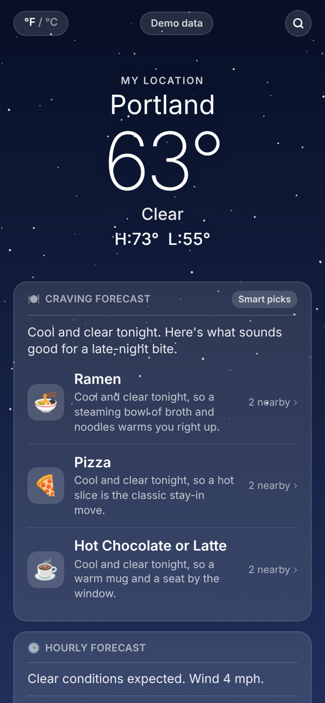

# BiteCast

**The weather, plus what to eat in it and where to find it nearby.**

BiteCast looks like a weather app, because it is one. Alongside the forecast it adds a *Craving Forecast*: three food ideas that fit the weather and the time of day, each linked to real places near you that serve it.

<table>
<tr>
<td width="33%"></td>
<td width="33%"></td>
<td width="33%"></td>
</tr>
<tr>
<td align="center">Cold and rainy at dinner</td>
<td align="center">Where to get it</td>
<td align="center">Hot and sunny at lunch</td>
</tr>
<tr>
<td width="33%"></td>
<td width="33%"></td>
<td></td>
</tr>
<tr>
<td align="center">Snowy breakfast</td>
<td align="center">Late night</td>
<td></td>
</tr>
</table>

<sub>Screenshots use the built-in demo mode, which has sample weather and made-up places.</sub>

## What it does

- **Live weather.** Current conditions, a 24-hour strip and a 10-day forecast, with a sky that changes with the weather: rain, snow, drifting clouds, stars at night and lightning in storms.
- **Food that fits.** Suggestions change with how the weather *feels* and the time of day. Ramen on a cold rainy evening, a poke bowl on a hot afternoon, pancakes on a snowy morning.
- **Places nearby.** Each suggestion lists nearby restaurants, cafés and shops that serve it, with distance, hours, directions and a link to find delivery.
- **Gemini when available.** With a Gemini API key, an agent picks the food using function calling. Without one, BiteCast uses its own weather rules, so it always works.
- **Phone first.** Opens in any phone browser and can be added to the home screen like an app. Search any city, and switch between °F and °C.

## How the Gemini agent works

The agent gets three tools and is told to check what is actually nearby before it recommends anything.

| Tool | What it returns |
|---|---|
| `get_weather` | Conditions, temperature, feels-like, today's high and low, local time and which meal it is |
| `nearby_cuisines` | How many places of each cuisine are within about 2.5 km |
| `find_places` | The closest places that likely serve a given dish |

Gemini calls the tools it needs, then answers with three picks as JSON. Each pick is matched to nearby places, preferring the specific match (a ramen shop for ramen) over a merely related one (any Japanese restaurant). If Gemini fails or returns something unusable, the app quietly falls back to the rule-based picks.

## How the rule-based picks work

Each of the 21 foods in [`src/lib/foods.ts`](src/lib/foods.ts) is described by whether it is best hot or cold, whether it is brothy or hearty, which meals it suits and which OpenStreetMap cuisines serve it. The score adds up:

- **How the weather feels.** Hot dishes score higher the colder it feels, cold dishes the hotter it feels.
- **Rain and snow.** Brothy and hearty food gets a boost.
- **Time of day.** This counts the most, so nobody is offered ramen at 8 in the morning.
- **Availability.** Foods with places nearby rank higher.

## Tech stack

Next.js · React · TypeScript · Tailwind CSS · Google Gemini API · Open-Meteo · OpenStreetMap (Overpass and Nominatim) · Vitest

No database and no accounts. The weather and map data are free services that need no API key.

## Run it locally

You need Node.js 20 or newer.

```bash
git clone https://github.com/Sarah-Kayembe/bitecast.git
cd bitecast
npm install
cp .env.example .env.local   # optional: add a Gemini key
npm run dev
```

Open [http://localhost:3000](http://localhost:3000) and allow location access, or search for a city.

To try it without location or internet, open [http://localhost:3000/?demo=rain](http://localhost:3000/?demo=rain). The other demo scenarios are `snow`, `sunny` and `night`.

## Tests

```bash
npm test
```

22 tests cover the food ranking in different weather, matching dishes to places, parsing weather and map data, and the full Gemini tool-calling loop against a simulated Gemini.

## Deploy

BiteCast is a standard Next.js app, so it deploys to Vercel as is. Add `GEMINI_API_KEY` as an environment variable to turn on the Gemini picks.

## Project structure

```
src/
  app/
    page.tsx              The app screen
    api/weather/          Forecast for a location
    api/cities/           City search
    api/suggest/          Food picks with nearby places
  components/
    Sky.tsx               Animated weather background
    Cards.tsx             Craving Forecast, hourly, 10-day and detail cards
    Sheets.tsx            Nearby places and city search
  lib/
    agent.ts              Gemini function-calling agent
    foods.ts              Food catalog, rule-based ranking and place matching
    places.ts             OpenStreetMap place search
    weather.ts            Open-Meteo forecast and geocoding
    demo.ts               Sample data for demo mode
tests/                    Vitest tests
```

## What's next

- Show whether each place is open right now
- Remember favorite foods and dietary preferences
- Deploy a public demo

## Credits

Weather data from [Open-Meteo](https://open-meteo.com). Map data © [OpenStreetMap](https://www.openstreetmap.org/copyright) contributors.

---

Built by [Sarah Kayembe](https://github.com/Sarah-Kayembe)
